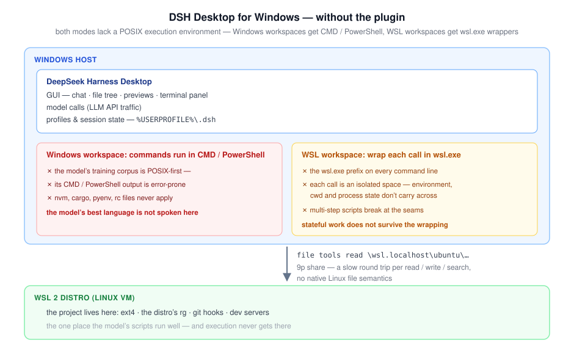
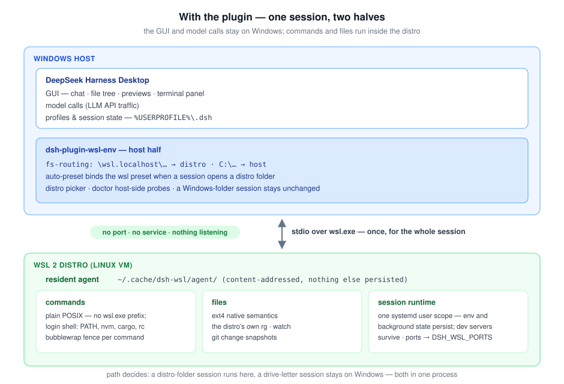

# dsh-plugin-wsl-env

**English** · [中文](docs/README.zh.md)

[](https://github.com/Big-Dao/dsh-plugin-wsl-env/actions/workflows/ci.yml)
[](https://www.npmjs.com/package/dsh-plugin-wsl-env)
[](LICENSE)

Turns a WSL 2 distro into the execution environment of a [DeepSeek Harness](https://github.com/deepseek-ai/deepseek-harness) desktop session: commands, files and the terminal all run inside the distro, while the harness stays on Windows. DeepSeek Harness ships in two forms — an npm CLI with a web UI, and a desktop app for macOS and Windows; this plugin serves one combination only, the desktop app on Windows with the project in a WSL 2 distro. No service installed in the distro, no port opened; confined commands run under the `bubblewrap` sandbox.





**New here?** Start with [docs/QUICKSTART.md](docs/QUICKSTART.md).

## Why this plugin

"When the agent keeps failing on a WSL project, make the desktop app work directly in the distro's environment — no moving, no service, no giving up the sandbox."

- The model's strength is POSIX, its weakness CMD/PowerShell: a Windows workspace gets only the weakness, and a WSL workspace gets `wsl.exe` wrapping that loses environment and state. This plugin runs the scripts unchanged in a persistent distro session.
- Commands run in the distro's login shell: `PATH`, `nvm`, `cargo`, `pyenv` and rc files all apply.
- No service in the distro, no port; the only persisted artifact is the agent cache under `~/.cache/dsh-wsl/agent/`.
- Confined commands run under `bubblewrap` by default; without bwrap the command fails, never runs unconfined.
- The environment is per session: a distro folder runs in the distro, a Windows folder stays Windows — both in one process.
- GUI integrated: the folder picker lists distros, the terminal opens in the distro, the model sees listening ports.

The full argument (why Linux rather than PowerShell, value and costs) is in [docs/VALUE.md](docs/VALUE.md).

## Install

The desktop app has no `dsh` executable; the plugin installs through the in-app Plugins page. Three steps:

1. `wsl.exe -d <distro> -u root -- apt-get install -y bubblewrap`
2. Plugins page: **Add plugin** → `dsh-plugin-wsl-env`, enable it.
3. Restart the app, open a folder inside the distro; type `/wsl-doctor` (host-side) for a `ready`/`blocked` verdict.

Remaining prerequisites (no Node.js needed inside the distro):

| Prerequisite | Notes |
|---|---|
| Windows 10/11 + WSL 2 + ≥1 distro | `wsl.exe -l -v` shows `VERSION 2`; otherwise `wsl.exe --install` |
| systemd + Linger (default session sandbox) | `[boot] systemd=true` in `/etc/wsl.conf`, `wsl --shutdown`, run `loginctl enable-linger "$USER"` once; without systemd set `sessionSandbox` to `auto` or `false` |
| Optional: `ripgrep`, `git`, `inotify-tools` | `pnpm run bootstrap <distro>` prints the install commands |

The plugin never edits the installed `resources/app.asar`. Upgrade = install again and restart; uninstall on the Plugins page, then `~/.cache/dsh-wsl` can be deleted. Details in [docs/QUICKSTART.md](docs/QUICKSTART.md).

## Do I need this plugin?

If the harness can run entirely inside the distro, skip this plugin: install the CLI in the distro (commands in [QUICKSTART §0](docs/QUICKSTART.md)). Use this plugin when the harness must stay on Windows:

| Setup | What to use |
|---|---|
| a terminal or browser UI is enough | the CLI inside the distro |
| the Windows desktop app, commands and files in the distro | this plugin |
| one session reaching both Windows and WSL folders | this plugin |

One trap: the `desktop` profile name is owned by the Electron app, and the npm CLI refuses to manage its plugins — use the in-app Plugins page. Full comparison in [docs/VALUE.md](docs/VALUE.md).

## Using it

Open a distro folder as the workspace, e.g. `\\wsl.localhost\ubuntu\home\you\project`.

- A folder opened in any distro runs in that distro.
- Commands run in the distro's login shell; `/home/you/x` and `\\wsl.localhost\ubuntu\home\you\x` are the same file.
- **New terminal** opens a shell in the same distro and directory.
- The model sees listening ports and returns dev-server URLs (WSL 2 forwards localhost).
- Permissions: `read-only` / `workspace-write` (default) / `danger-full-access`; only the last runs without the sandbox.
- The sidebar **WSL environment** panel diagnoses per distro; see [docs/DIAGNOSTICS.md](docs/DIAGNOSTICS.md).

## How it compares

| | Desktop remote (VS Code, ZCode) | This plugin |
|---|---|---|
| Inside the distro | a helper server | one cached agent binary |
| Network | a listening port | none |
| Command sandbox | none | `bubblewrap` |
| Removal | delete the server | delete the cache |

A desktop remote is more mature; a CLI inside WSL is simpler. This plugin is for: the harness stays on Windows and commands must be sandboxed.

## Configure

Settings live on named rows in `$DSH_HOME/profiles/<name>/cordis.patch.yml`. `wsl-shell`/`wsl-fs` are nested inside `preset-wsl`; overriding them by id does not work — override the whole row. Every key and recipe is in [docs/CONFIGURATION.md](docs/CONFIGURATION.md); [`cordis.patch.yml`](cordis.patch.yml) is the commented reference for the shipped values.

## Architecture

```text
app level (per process)
├─ directory-picker-wsl, workspace-files, subprocess-wsl
├─ fs-routing: root filesystem routed by path
└─ auto-preset: binds the wsl preset when a session opens a distro folder

wsl preset (per session)
├─ wsl-shell: commands
└─ wsl-fs: file operations
```

Commands and file operations go through a resident agent in the distro (systemd user scope + `bubblewrap` profile). Distro UNC paths route to the distro; drive-letter paths stay on the host. See [docs/ARCHITECTURE.md](docs/ARCHITECTURE.md).

## Sandbox

| Mode | What a command can do |
|---|---|
| `read-only` | read the whole distro; only a fresh `/dev` is mounted, nothing else writable |
| `workspace-write` | plus the session workspace and any configured `writableRoots` |
| `danger-full-access` | no sandbox |

Without `bubblewrap`, confined commands report `SANDBOX_UNAVAILABLE` and do not run. Enforcement is `partial`: a process inside the distro can still start Windows programs through `/mnt/c`. See [docs/ARCHITECTURE.md](docs/ARCHITECTURE.md#sandbox) and [SECURITY.md](SECURITY.md).

## Troubleshooting

| Symptom | Fix |
|---|---|
| every command reports `SANDBOX_UNAVAILABLE` | install `bubblewrap` in the distro, or set `sandbox: false` |
| the session refuses before the first command | run `pnpm run doctor`; enable systemd and linger, or set `sessionSandbox` to `auto` or `false` on `wsl-shell` and `wsl-fs` |
| `glob` and `grep` are slow in the distro | run `pnpm run bootstrap <distro>` and use its printed install command to install `ripgrep` |
| `npm install` / `pnpm add` fail with `EROFS` | the sandbox grants only the workspace by default; configure `writableRoots` on `wsl-shell` and `wsl-fs` (e.g. `~/.npm`, `~/.cache`, `~/.local/share/pnpm`); see [CONFIGURATION](docs/CONFIGURATION.md#toolchain-caches-and-extra-writable-roots) |
| the Plugins page finishes without feedback | trust the profile's `package.json` and its `dsh.profile.bundles` entry: the plugin listed there is installed |
| a profile patch for `wsl-shell`/`wsl-fs` changes nothing | those rows are nested inside `preset-wsl`. Run `pnpm run preset --check <patch>`; it fails with the complete block to paste |
| changes under `lib/` have no effect | run `pnpm run sync:windows`, then restart the app |

More error codes in [docs/ARCHITECTURE.md](docs/ARCHITECTURE.md#error-codes); what the plugin does not do is in [docs/LIMITATIONS.md](docs/LIMITATIONS.md).

## Development

```bash
pnpm install           # development dependencies
pnpm run build         # compile src/ into lib/ (lib/ is committed)
pnpm test              # style, links, requirement citations, doc consistency, syntax, build consistency, types, unit tests
pnpm run test:coverage # unit tests with coverage thresholds
pnpm run sync:windows  # update the Windows-side copy the app loads
```

Node `^22.19.0 || >=24.0.0`; `src/` is TypeScript, `lib/` is the committed build output. Real-machine probes run on Windows + WSL only. See [CONTRIBUTING.md](CONTRIBUTING.md) and `test/probe/`.

## Documentation

| Document | Content |
|---|---|
| [docs/QUICKSTART.md](docs/QUICKSTART.md) | first run, recipes, compatibility |
| [docs/PERFORMANCE.md](docs/PERFORMANCE.md) | ext4 agent vs 9p, measured latency, how to reproduce |
| [docs/MIGRATION.md](docs/MIGRATION.md) | upgrading from earlier versions, release gates |
| [docs/COMPATIBILITY.md](docs/COMPATIBILITY.md) | the tested Windows/WSL/distro matrix and scope decisions |
| [docs/API.md](docs/API.md) | the package's subpath exports at a glance |
| [docs/CONFIGURATION.md](docs/CONFIGURATION.md) | every configuration key and how to override it |
| [docs/ARCHITECTURE.md](docs/ARCHITECTURE.md) | services, path routing, sandbox, error codes |
| [docs/LIMITATIONS.md](docs/LIMITATIONS.md) | what the plugin does not do |
| [docs/ROADMAP.md](docs/ROADMAP.md) | current plan and deferred work |
| [docs/ROADMAP-1.0.md](docs/ROADMAP-1.0.md) | the 1.0 and ecosystem plan |
| [docs/VALUE.md](docs/VALUE.md) | value and trade-offs |
| [CONTRIBUTING.md](CONTRIBUTING.md) | development loop, gates, probes |
| [SECURITY.md](SECURITY.md) | private vulnerability reporting |
| [SUPPORT.md](SUPPORT.md) | supported versions and support channels |
| [docs/RELEASING.md](docs/RELEASING.md) | release checklist |

## License

MIT. See [LICENSE](LICENSE).
