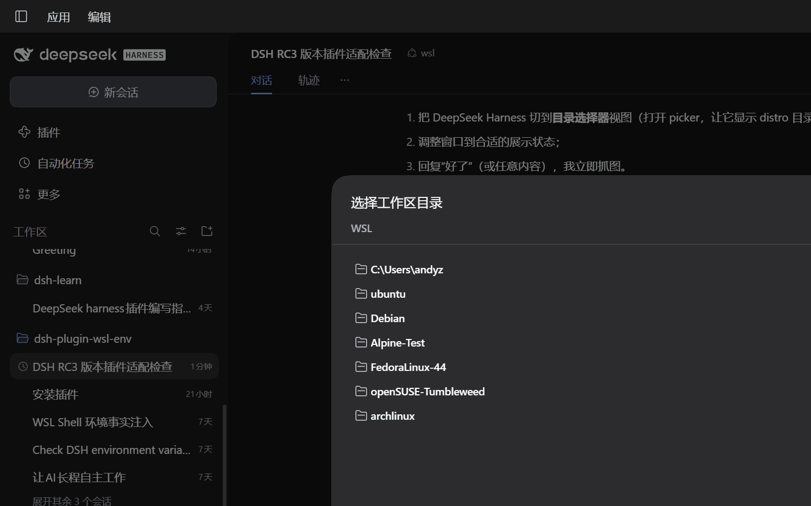
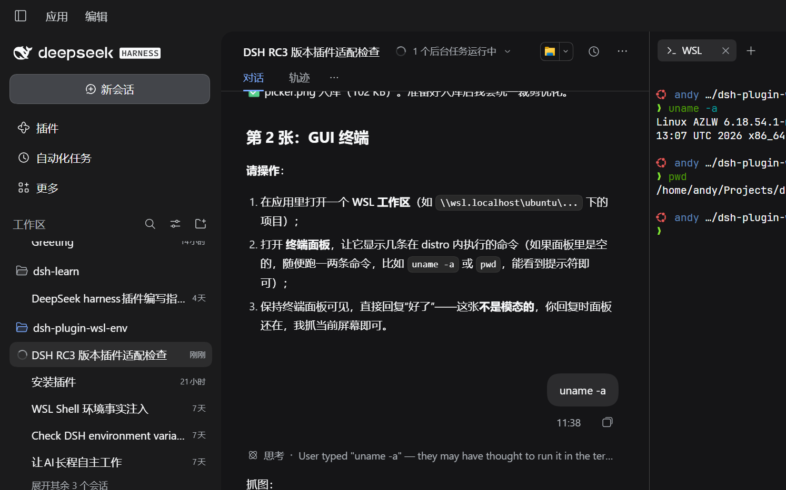
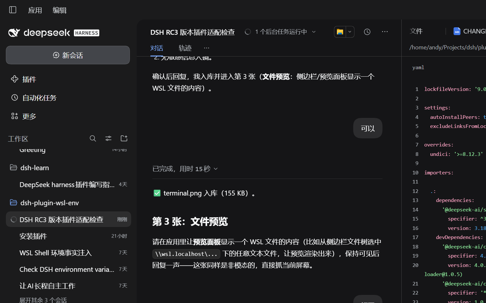
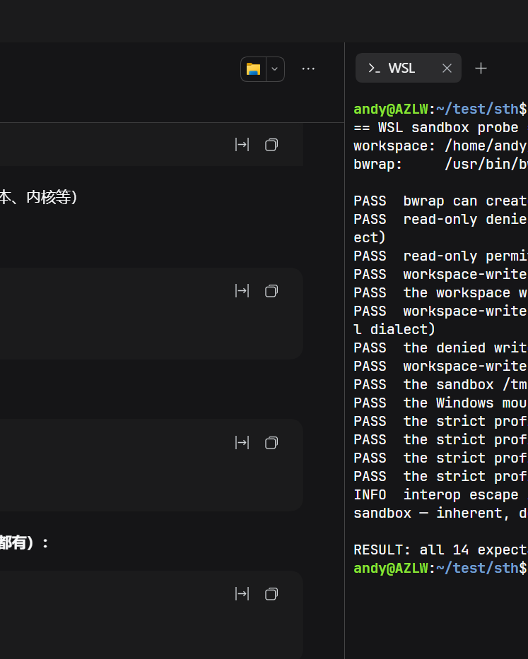

# Quickstart

Steps from a Windows + WSL 2 machine to a working WSL session.
This page is the entry point; every claim links to the document that owns it.

## 1. Prerequisites

| Need | How to check | If missing |
|---|---|---|
| Windows 10/11 with WSL 2 | `wsl.exe -l -v` shows `VERSION 2` | `wsl.exe --install` |
| A distro | one line in the list above | `wsl.exe --install -d Ubuntu` |
| `bubblewrap` | `wsl.exe -d <distro> -- which bwrap` | `wsl.exe -d <distro> -u root -- apt-get install -y bubblewrap` |
| systemd + Linger (for the session runtime) | `node <plugin>/scripts/doctor.mjs` (installed) or `pnpm run doctor` (checkout) | `[boot] systemd=true` in `/etc/wsl.conf`, `wsl --shutdown`, then `loginctl enable-linger "$USER"`; or set `sessionSandbox: auto`/`false` |
| Node `^22.19.0` or `>=24.0.0` | only needed for source/development work | not needed inside the distro to use the published plugin |

The doctor (`scripts/doctor.mjs`, or `pnpm run doctor` from a checkout) checks
the environment and prints remedies for detected failures. Confirm the distro's
WSL version separately with `wsl.exe -l -v`. Doctor is read-only unless you pass `--fix` (stale scopes) or
`--fix --install` (packages, after a confirmation).

## 2. Install

From a Windows PowerShell where the DSH CLI is available:

```powershell
dsh plugin --profile <profile> add dsh-plugin-wsl-env
# 若解析到旧版本（发布当天的元数据缓存），显式指定：
# dsh plugin --profile <profile> add dsh-plugin-wsl-env@<latest>
dsh --profile <profile> --dump-config      # the plugin rows must be there
```

For a profile that already overrides the preset, keep the override as the full
`preset-wsl` block — `pnpm run preset --check <patch>` fails loudly when a layer
targets `wsl-shell`/`wsl-fs` by id.

## 3. Open a WSL workspace

In the GUI, open a folder through the picker (`\\wsl.localhost\<distro>\home\<you>\proj`)
or an UNC path directly. The session's commands, file tools, terminal and previews
all run in that distro; a Windows folder keeps the normal Windows environment.
Two distros can be open at once, each with its own environment.

### Open the workspace in VS Code (Remote-WSL)

Opening the WSL folder as a Windows UNC share works but is the degraded mode:
files cross 9p, the terminal is PowerShell, extensions run on Windows. The full
integration is VS Code's Remote-WSL — the server runs inside the distro, the
integrated terminal is the distro shell, and file operations are local ext4:

```powershell
# from the plugin checkout:
scripts/open-wsl-vscode.ps1 -Path "\\wsl.localhost\ubuntu\home\me\proj"
# or by hand:
code --folder-uri "vscode-remote://wsl+ubuntu/home/me/proj"
```

Requires the `code` shim on PATH (VS Code installer adds it) and the
Remote-WSL extension.



The terminal panel runs in the same distro — `uname -a` answers with the
distro's kernel, not Windows':



And the Sidebar's preview renders WSL files in place:



## 4. Verify

Ask for a command, e.g. `pwd && uname -a`. Expected: the Linux path and the
distro kernel. If the first command fails, the error names the remedy; the
[doctor](CONFIGURATION.md) and the [Troubleshooting table](../README.md#troubleshooting)
cover the common cases.

The probe below runs the shipped kernel-enforced bwrap profiles live — writes
inside the workspace land, tested writes outside are refused with `EROFS`, and
the strict profile hides `/mnt` entirely
([`test/probe/sandbox.sh`](https://github.com/Big-Dao/dsh-plugin-wsl-env/blob/main/test/probe/sandbox.sh)):

This is partial isolation, not a Windows security boundary: Windows interop
can still launch executables outside `/mnt`. See [LIMITATIONS.md](LIMITATIONS.md).



## Recipes

Commands run in the model's session, inside the distro, from the workspace root.

### Node / TypeScript

```bash
node -v && pnpm -v
pnpm install
pnpm test
pnpm dev            # a dev server survives the command that started it with sessionSandbox: true
```

The server's port can appear in `DSH_WSL_PORTS` after a successful snapshot
(refreshed every 10 s by default); open a forwarded port from Windows at
`http://localhost:<port>`.

### Python

```bash
python3 -m venv .venv && . .venv/bin/activate
pip install -r requirements.txt
python -m pytest
```

Use the distro's interpreter, not a Windows one: the session's `python3` is the
one on the distro `PATH` (pyenv/conda shims included).

### Rust

```bash
cargo build --release
cargo test
```

Targets are compiled natively for the distro's architecture (x86_64 or aarch64);
do not reuse Windows `target/` directories.

### Go

```bash
go build ./...
go test ./...
```

The module cache normally lives under the distro user's `$GOPATH`; its actual
location and backing filesystem depend on the Go environment and mounts.

### Monorepo

Open the repository root as the workspace. Each package's commands run from the
same distro; `pnpm -r`, `turbo`, `nx` and `make` see one Linux filesystem. The
file watcher uses inotify for unbounded directories when `inotifywait` is
available; otherwise it falls back to polling. If a change is missed, see the
watcher bounds in [CONFIGURATION.md](CONFIGURATION.md).

## Compatibility

Honest status, not a promise. "Probed" means a real-machine run is recorded in
this repository; "target" means the design supports it but the leg has not been
executed here.

| Tier | Configuration | Status |
|---|---|---|
| 1 | Ubuntu / Debian, systemd, x86_64 | Probed. Debian harness-level probes pass against a `wslfs-debian` profile (2026-10-26). |
| 2 | Fedora, openSUSE, Arch, Alpine; aarch64 native agent | Distro matrix in [COMPATIBILITY.md](COMPATIBILITY.md). aarch64 18-check runs under qemu in CI; physical aarch64 WSL is out of scope. |
| Unsupported | WSL 1, Linux/macOS hosts, Windows without WSL 2 | Not supported; the plugin attaches to `wsl.exe` |

With `sessionSandbox: auto` a distro without systemd/Linger still gets the
per-command `bubblewrap` sandbox and the result reports the narrower scope;
`true` refuses. See [CONFIGURATION.md](CONFIGURATION.md#sandbox-and-preflight) for
the sandbox trade-offs and [PERFORMANCE.md](PERFORMANCE.md) for the measured
latency.

## Demo

The screenshots above show the picker, terminal, preview and sandbox probe.
There is no GIF yet. The [Troubleshooting table](../README.md#troubleshooting)
and the probe output (`pnpm run probe:sandbox`, `pnpm run probe:gui-preview`)
provide reproducible evidence; the remaining demo work is tracked in
[ROADMAP-1.0.md](ROADMAP-1.0.md#wsl-302--discoverability-and-docs-entry).
