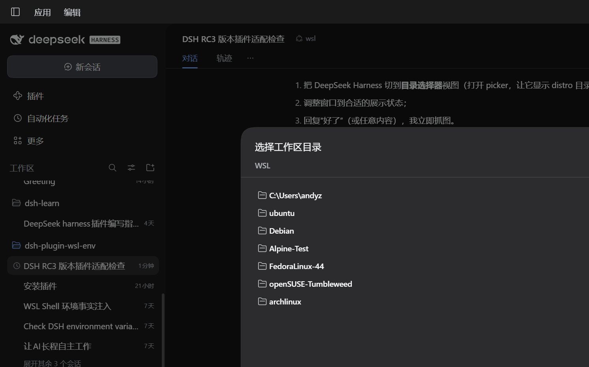
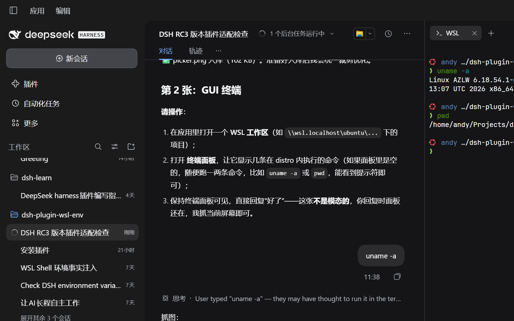
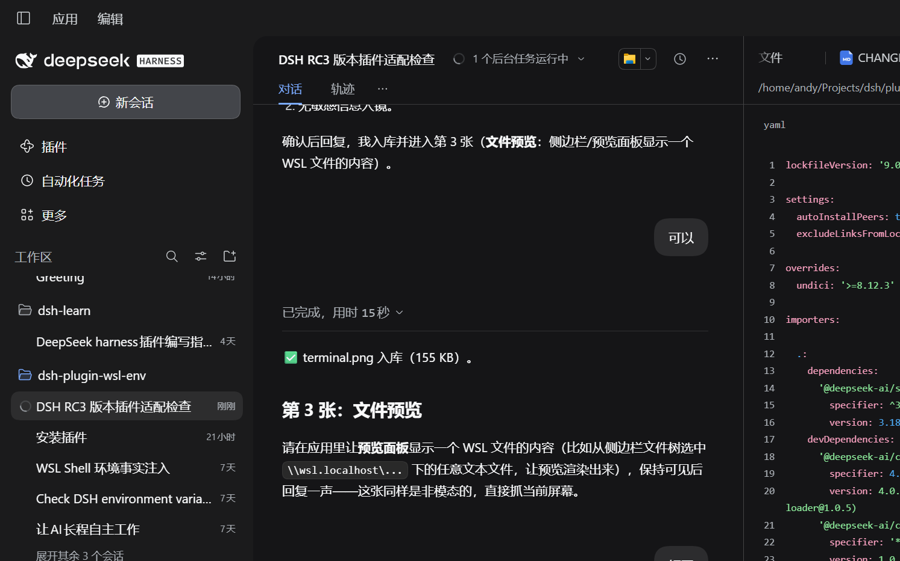
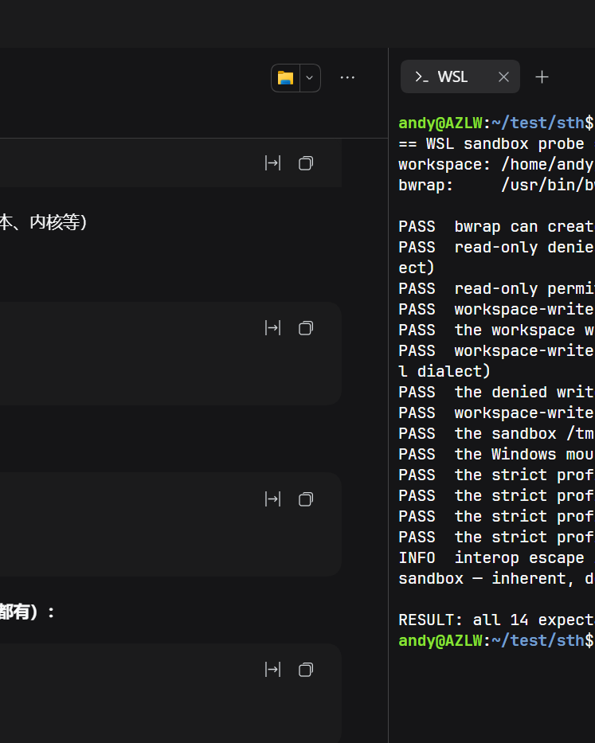

# Quickstart

_本文是 [QUICKSTART](QUICKSTART.md) 的中文译本，以英文版为准。_

从一台 Windows + WSL 2 机器到可用的 WSL 会话，只需以下步骤。
本页是入口；每条说明都链接到负责该主题的文档。

## 0. 需要这个插件吗？

如果 harness 可以整个跑在发行版里，把 CLI 装进去（`npm install -g
@deepseek-ai/dsh`）并跳过本插件会更简单——判断表见
[README](README.zh.md#需要这个插件吗)。本页其余部分假定桌面应用留在 Windows，
由本插件提供 WSL 环境。

## 1. 前置条件

| 需求 | 如何检查 | 缺失时 |
|---|---|---|
| Windows 10/11，启用 WSL 2 | `wsl.exe -l -v` 显示 `VERSION 2` | `wsl.exe --install` |
| 一个发行版 | 上面列表中有一行 | `wsl.exe --install -d Ubuntu` |
| `bubblewrap` | `wsl.exe -d <distro> -- which bwrap` | `wsl.exe -d <distro> -u root -- apt-get install -y bubblewrap` |
| systemd + Linger（会话 runtime 需要） | `node <plugin>/scripts/doctor.mjs`（已安装）或 `pnpm run doctor`（检出目录） | 在 `/etc/wsl.conf` 设置 `[boot] systemd=true`，`wsl --shutdown`，然后 `loginctl enable-linger "$USER"`；或设置 `sessionSandbox: auto`/`false` |
| Node `^22.19.0` 或 `>=24.0.0` | 仅源码/开发工作需要 | 使用已发布的插件时，发行版内不需要 Node |

doctor（`scripts/doctor.mjs`，或在检出目录中运行 `pnpm run doctor`）会检查
环境并针对检测到的失败打印补救方法。发行版的 WSL 版本请单独用
`wsl.exe -l -v` 确认。doctor 默认只读，除非传入 `--fix`（清理过期 scope）或
`--fix --install`（安装软件包，需确认）。

## 2. 安装

桌面应用没有 `dsh` 命令；在侧边栏打开 **插件**，点 **Add plugin**，按精确包名
`dsh-plugin-wsl-env` 安装。这一步写入该 profile 的 `package.json` 与
`dsh.profile.bundles`。

使用 CLI 发行版（`dsh` 在 `PATH` 上）时，在 Windows PowerShell 中：

```powershell
dsh plugin --profile <profile> add dsh-plugin-wsl-env
# 若解析到旧版本（发布当天的元数据缓存），显式指定：
# dsh plugin --profile <profile> add dsh-plugin-wsl-env@<latest>
dsh --profile <profile> --dump-config      # 输出中必须包含插件的行
```

如果 profile 已覆盖 preset，请保持覆盖为完整的
`preset-wsl` 块——当某个层直接按 id 指向 `wsl-shell`/`wsl-fs` 时，
`pnpm run preset --check <patch>` 会明确报错。

## 3. 打开 WSL 工作区

启动桌面应用的方式与它安装的快捷方式一致：`DeepSeek Harness.exe`，不带参数——
它打开的是应用自己配置的 profile（也就是 Plugins 页面写入的那个）。（CLI
发行版：`dsh --profile <名字>` 启动指定名字的 profile。）

在 GUI 中，通过选择器打开文件夹（`\\wsl.localhost\<distro>\home\<you>\proj`），
或直接打开 UNC 路径。会话的命令、文件工具、终端和预览
都在该发行版中运行；打开 Windows 文件夹则保留正常的 Windows 环境。
两个发行版可以同时打开，各自拥有自己的环境。

### 在 VS Code 中打开工作区（Remote-WSL）

把 WSL 文件夹当作 Windows UNC 共享打开也可行，但属于降级模式：
文件走 9p，终端是 PowerShell，扩展运行在 Windows 上。完整的
集成方式是 VS Code 的 Remote-WSL——server 运行在发行版内，集成终端
是发行版的 shell，文件操作直接落在本地 ext4 上：

```powershell
# from the plugin checkout:
scripts/open-wsl-vscode.ps1 -Path "\\wsl.localhost\ubuntu\home\me\proj"
# or by hand:
code --folder-uri "vscode-remote://wsl+ubuntu/home/me/proj"
```

要求 PATH 上有 `code` shim（VS Code 安装器会添加），以及
Remote-WSL 扩展。



终端面板运行在同一个发行版中——`uname -a` 返回的是
发行版的内核，而不是 Windows 的：



侧边栏的预览也能就地渲染 WSL 文件：



## 4. 验证

让模型执行一条命令，例如 `pwd && uname -a`。预期结果：Linux 路径和
发行版内核。如果第一条命令失败，错误信息会给出补救方法；
[doctor](CONFIGURATION.md) 和[故障排查表](../README.md#troubleshooting)
覆盖了常见情况。

下面的探针会实时运行随包的、由内核强制的 bwrap profile——
工作区内的写入生效，测试性的区外写入被以 `EROFS` 拒绝，
严格 profile 则把 `/mnt` 完全隐藏
（[`test/probe/sandbox.sh`](https://github.com/Big-Dao/dsh-plugin-wsl-env/blob/main/test/probe/sandbox.sh)）：

这是部分隔离，不是 Windows 安全边界：Windows interop
仍可启动 `/mnt` 之外的可执行文件。见 [LIMITATIONS.md](LIMITATIONS.md)。



## 配方

命令在模型的会话中运行，位于发行版内，从工作区根目录出发。

### Node / TypeScript

```bash
node -v && pnpm -v
pnpm install
pnpm test
pnpm dev            # a dev server survives the command that started it with sessionSandbox: true
```

快照成功后（默认每 10 s 刷新一次），server 的端口可能出现在 `DSH_WSL_PORTS`
中；从 Windows 通过 `http://localhost:<port>` 访问转发的端口。

### Python

```bash
python3 -m venv .venv && . .venv/bin/activate
pip install -r requirements.txt
python -m pytest
```

使用发行版的解释器，而不是 Windows 的：会话的 `python3` 是
发行版 `PATH` 上的那个（包括 pyenv/conda shim）。

### Rust

```bash
cargo build --release
cargo test
```

target 会针对发行版的架构（x86_64 或 aarch64）原生编译；
不要复用 Windows 的 `target/` 目录。

### Go

```bash
go build ./...
go test ./...
```

模块缓存通常位于发行版用户的 `$GOPATH` 下；其实际位置和底层文件系统
取决于 Go 环境和挂载情况。

### Monorepo

把仓库根目录作为工作区打开。每个包的命令都在同一个发行版中运行；
`pnpm -r`、`turbo`、`nx` 和 `make` 看到的是同一个 Linux 文件系统。
当 `inotifywait` 可用时，无上限目录的文件监视使用 inotify；
否则回退到轮询。如果遗漏了某次变更，见
[CONFIGURATION.md](CONFIGURATION.md) 中的监视器边界。

## 兼容性

诚实的现状，不是承诺。"已探针"指本仓库记录了一次真机运行；
"目标"指设计上支持，但这条腿尚未在这里执行过。

| 层级 | 配置 | 状态 |
|---|---|---|
| 1 | Ubuntu / Debian，systemd，x86_64 | 已探针。Debian 的 harness 级探针针对 `wslfs-debian` profile 通过（2026-10-26）。 |
| 2 | Fedora、openSUSE、Arch、Alpine；aarch64 原生 agent | 发行版矩阵见 [COMPATIBILITY.md](COMPATIBILITY.md)。aarch64 的 18 项检查在 CI 中于 qemu 下运行；物理 aarch64 WSL 不在范围内。 |
| 不支持 | WSL 1、Linux/macOS 宿主、无 WSL 2 的 Windows | 不支持；插件依附于 `wsl.exe` |

设置 `sessionSandbox: auto` 时，没有 systemd/Linger 的发行版仍能获得
按命令的 `bubblewrap` 沙箱，且结果会报告更窄的 scope；
`true` 则直接拒绝。沙箱取舍见
[CONFIGURATION.md](CONFIGURATION.md#sandbox-and-preflight)，实测延迟见
[PERFORMANCE.md](PERFORMANCE.md)。

## 演示

上面的截图展示了选择器、终端、预览和沙箱探针。
目前还没有 GIF。[故障排查表](../README.md#troubleshooting)
和探针输出（`pnpm run probe:sandbox`、`pnpm run probe:gui-preview`）
提供了可复现的证据；其余演示工作在
[ROADMAP-1.0.md](ROADMAP-1.0.md#wsl-302--discoverability-and-docs-entry) 中跟踪。
