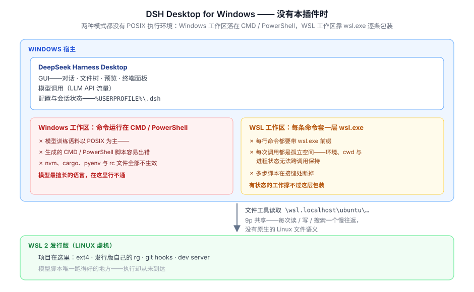
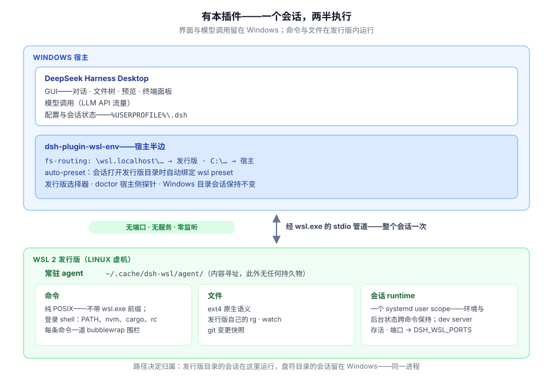

# dsh-plugin-wsl-env

[English](../README.md) · **中文**

[](https://github.com/Big-Dao/dsh-plugin-wsl-env/actions/workflows/ci.yml)
[](https://www.npmjs.com/package/dsh-plugin-wsl-env)
[](../LICENSE)

把 WSL 2 发行版变成 [DeepSeek Harness](https://github.com/deepseek-ai/deepseek-harness) 桌面会话的执行环境：命令、文件、终端都在发行版内运行，harness 留在 Windows。DeepSeek Harness 有两种形态——带 Web UI 的 npm CLI，与 macOS/Windows 桌面应用；本插件只服务其中一种组合：Windows 桌面应用 + WSL 2 中的项目。发行版内不装服务、不开端口；受限命令经 `bubblewrap` 沙箱。





**刚接触？** 从 [QUICKSTART.zh.md](QUICKSTART.zh.md) 开始。

## 为什么用这个插件

「agent 在 WSL 项目上反复失败时，让桌面应用直接在发行版环境里工作——不搬家、不装服务、不放弃沙箱。」

- 模型的强项是 POSIX，弱项是 CMD/PowerShell：Windows 工作区只能用弱项，WSL 工作区经 `wsl.exe` 逐条包装又丢失环境与状态。本插件让脚本在持久的发行版会话里原样运行。
- 命令跑在发行版登录 shell：`PATH`、`nvm`、`cargo`、`pyenv`、rc 文件全部生效。
- 发行版内无服务、无端口；唯一持久物是 `~/.cache/dsh-wsl/agent/` 下的 agent 缓存。
- 受限命令默认经 `bubblewrap`；缺 bwrap 时命令失败，不脱箱。
- 环境按会话生效：发行版目录会话进发行版，Windows 目录会话不变，可同进程并存。
- 与 GUI 集成：文件夹选择器列出发行版，终端在发行版内打开，模型可见监听端口。

完整论证（为什么是 Linux 而不是 PowerShell、价值与代价）见 [VALUE.zh.md](VALUE.zh.md)。

## 安装

桌面应用没有 `dsh` 可执行程序；插件经 **Plugins** 页安装。三步：

1. `wsl.exe -d <发行版> -u root -- apt-get install -y bubblewrap`
2. Plugins 页：**Add plugin** → `dsh-plugin-wsl-env`，启用。
3. 重启应用，打开发行版内的文件夹；输入 `/wsl-doctor`（宿主侧执行）得到 `ready`/`blocked` 裁决。

其余前置（发行版内不需要 Node.js）：

| 前置 | 说明 |
|---|---|
| Windows 10/11 + WSL 2 + ≥1 个发行版 | `wsl.exe -l -v` 显示 `VERSION 2`；缺则 `wsl.exe --install` |
| systemd + Linger（默认会话沙箱需要） | `/etc/wsl.conf` 设 `[boot] systemd=true`，`wsl --shutdown`，执行一次 `loginctl enable-linger "$USER"`；无 systemd 时设 `sessionSandbox` 为 `auto` 或 `false` |
| 可选：`ripgrep`、`git`、`inotify-tools` | `pnpm run bootstrap <发行版>` 打印安装命令 |

插件不修改已安装的 `resources/app.asar`。升级 = 重新安装后重启；卸载在 Plugins 页面，之后可删 `~/.cache/dsh-wsl`。细节见 [QUICKSTART.zh.md](QUICKSTART.zh.md)。

## 需要这个插件吗？

harness 能整个跑在发行版里时，不用本插件更简单：把 CLI 装进发行版即可（命令见 [QUICKSTART §0](QUICKSTART.zh.md)）。harness 必须留在 Windows 时才用本插件：

| 场景 | 用什么 |
|---|---|
| 终端或浏览器界面够用 | 发行版内的 CLI |
| 要 Windows 桌面应用，命令与文件在发行版 | 本插件 |
| 一个会话同时访问 Windows 与 WSL 目录 | 本插件 |

坑：`desktop` profile 名由 Electron 应用独占，npm CLI 拒绝管理它的插件——用应用内 Plugins 页。完整对照见 [VALUE.zh.md](VALUE.zh.md)。

## 使用

打开发行版文件夹作为工作区，如 `\\wsl.localhost\ubuntu\home\you\project`。

- 打开哪个发行版的文件夹，就在哪个发行版执行。
- 命令在发行版登录 shell 中运行；`/home/you/x` 与 `\\wsl.localhost\ubuntu\home\you\x` 是同一文件。
- **New terminal** 在同一发行版、同一目录打开 shell。
- 模型可见监听端口并返回 dev server URL（WSL 2 转发 localhost）。
- 权限：`read-only` / `workspace-write`（默认）/ `danger-full-access`；只有最后一档不经沙箱。
- 侧边栏 **WSL 环境** 面板按发行版诊断，见 [DIAGNOSTICS.zh.md](DIAGNOSTICS.zh.md)。

## 方案对比

| | 桌面远程（VS Code、ZCode） | 本插件 |
|---|---|---|
| 发行版内 | 辅助服务 | 一个缓存的 agent 可执行文件 |
| 网络 | 监听端口 | 无 |
| 命令沙箱 | 无 | `bubblewrap` |
| 卸载 | 删除服务 | 删除缓存 |

桌面远程更成熟；CLI 装进 WSL 更简单。本插件用于：harness 留在 Windows，且命令需要沙箱。

## 配置

配置在 `$DSH_HOME/profiles/<名字>/cordis.patch.yml` 的命名行上。`wsl-shell`/`wsl-fs` 嵌套在 `preset-wsl` 里，按 id 覆盖无效，须整行覆盖。全部键与配方见 [CONFIGURATION.zh.md](CONFIGURATION.zh.md)；[`cordis.patch.yml`](../cordis.patch.yml) 是随包值的注释参考。

## 架构

```text
应用层（每进程）
├─ directory-picker-wsl、workspace-files、subprocess-wsl
├─ fs-routing：根级文件系统按路径分流
└─ auto-preset：会话打开发行版目录时绑定 wsl preset

wsl preset（每会话）
├─ wsl-shell：命令
└─ wsl-fs：文件操作
```

命令与文件走发行版内常驻 agent（systemd user scope + `bubblewrap` profile）。发行版 UNC 路径进发行版，盘符路径留宿主。详见 [ARCHITECTURE.zh.md](ARCHITECTURE.zh.md)。

## 沙箱

| 模式 | 命令可以做什么 |
|---|---|
| `read-only` | 读整个发行版；仅新挂载的 `/dev`，其余不可写 |
| `workspace-write` | 加上会话工作区与配置的 `writableRoots` |
| `danger-full-access` | 不经沙箱 |

缺 `bubblewrap` 时受限命令报 `SANDBOX_UNAVAILABLE`，不运行。隔离为 `partial`：发行版内进程仍可经 `/mnt/c` 启动 Windows 程序。详见 [ARCHITECTURE.zh.md](ARCHITECTURE.zh.md#沙箱) 与 [SECURITY.zh.md](../SECURITY.zh.md)。

## 常见问题

| 现象 | 处理 |
|---|---|
| 每条命令都报 `SANDBOX_UNAVAILABLE` | 在发行版内安装 `bubblewrap`，或设置 `sandbox: false` |
| 会话在第一条命令前就被拒绝 | 运行 `pnpm run doctor`；启用 systemd 和 linger，或把 `wsl-shell`、`wsl-fs` 上的 `sessionSandbox` 设为 `auto` 或 `false` |
| 发行版内 `glob`、`grep` 很慢 | 运行 `pnpm run bootstrap <发行版>`，使用打印的安装命令安装 `ripgrep` |
| `npm install` / `pnpm add` 报 `EROFS` | 沙箱默认只授予工作区；在 `wsl-shell` 和 `wsl-fs` 上配置 `writableRoots`（如 `~/.npm`、`~/.cache`、`~/.local/share/pnpm`），见 [CONFIGURATION](CONFIGURATION.zh.md#工具链缓存与额外可写目录) |
| Plugins 页面装完没有任何日志 | 以 profile 的 `package.json` 与 `dsh.profile.bundles` 为准：列出插件即安装成功 |
| 对 `wsl-shell`/`wsl-fs` 的 profile 补丁不生效 | 这些行嵌套在 `preset-wsl` 里。运行 `pnpm run preset --check <补丁>`；它会失败并输出需要粘贴的完整块 |
| 改了 `lib/` 但不生效 | 运行 `pnpm run sync:windows`，然后重启应用 |

更多错误码见 [ARCHITECTURE.zh.md](ARCHITECTURE.zh.md#错误码)，插件不做的事见 [LIMITATIONS.zh.md](LIMITATIONS.zh.md)。

## 开发

```bash
pnpm install           # 开发依赖
pnpm run build         # 从 src/ 生成 lib/（lib/ 提交进仓）
pnpm test              # 风格、链接、需求引用、文档一致性、语法、构建一致性、类型、单元测试
pnpm run test:coverage # 带覆盖率阈值的单元测试
pnpm run sync:windows  # 更新应用加载的 Windows 侧副本
```

Node `^22.19.0 || >=24.0.0`；`src/` 是 TypeScript，`lib/` 是提交进仓的构建产物。真机探针仅 Windows + WSL。见 [CONTRIBUTING.zh.md](../CONTRIBUTING.zh.md) 与 `test/probe/`。

## 文档

| 文档 | 内容 |
|---|---|
| [QUICKSTART.zh.md](QUICKSTART.zh.md) | 首次运行、常用配方、兼容性 |
| [PERFORMANCE.zh.md](PERFORMANCE.zh.md) | ext4 agent 对比 9p 的实测延迟与复现方法 |
| [MIGRATION.zh.md](MIGRATION.zh.md) | 从早期版本升级、发布门槛 |
| [COMPATIBILITY.zh.md](COMPATIBILITY.zh.md) | 已测的 Windows/WSL/发行版矩阵与范围决定 |
| [API.zh.md](API.zh.md) | 包的子路径导出一览 |
| [CONFIGURATION.zh.md](CONFIGURATION.zh.md) | 所有配置键及覆盖方法 |
| [ARCHITECTURE.zh.md](ARCHITECTURE.zh.md) | 服务、路径路由、沙箱、错误码 |
| [LIMITATIONS.zh.md](LIMITATIONS.zh.md) | 插件不做的事 |
| [docs/ROADMAP.md](ROADMAP.md) | 当前计划和推迟项 |
| [docs/ROADMAP-1.0.md](ROADMAP-1.0.md) | 1.0 与生态优化计划 |
| [docs/VALUE.zh.md](VALUE.zh.md) | 价值与取舍 |
| [CONTRIBUTING.zh.md](../CONTRIBUTING.zh.md) | 开发循环、质量门、探针 |
| [SECURITY.zh.md](../SECURITY.zh.md) | 私下上报漏洞 |
| [SUPPORT.zh.md](../SUPPORT.zh.md) | 支持范围与提问渠道 |
| [docs/RELEASING.md](RELEASING.md) | 发布检查单 |

## 许可

MIT，见 [LICENSE](../LICENSE)。
